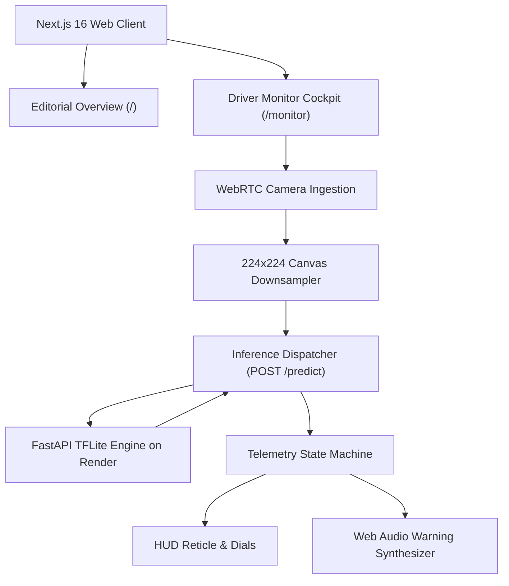

# AlertDrive Vision System | Product Requirements Document

**Project**: AlertDrive Driver Telemetry & Monitoring Interface  
**Deployment Target**: Vercel (Frontend Client) / Render (Inference Service)  
**Design Reference**: Wayve.ai (Autonomous Systems Design System)  
**Document Revision**: 2.0 (Human-Engineered Specification)  

---

## 1. System Overview

AlertDrive is a real-time driver state analysis interface connected to a localized quantized vision model. The system ingests camera frames, evaluates facial state vectors, and returns binary alertness classifications with confidence intervals.

The user interface follows Wayve's design philosophy: severe reduction of decorative elements, high-density telemetry, clear typographic hierarchy, and functional audio-visual warnings. Every pixel and line of copy is engineered for split-second readability in high-contrast and low-light cabin environments.

---

## 2. Technical Stack Specifications

* **Application Framework**: Next.js 16 (App Router)
* **Client Runtime**: React 19
* **Styling Engine**: Tailwind CSS 4 (CSS-first variable tokens)
* **Component Architecture**: shadcn/ui (Tailwind 4 variant, zero pre-bundled themes)
* **Iconography**: Phosphor Icons (`@phosphor-icons/react`, Regular and Duotone technical weights only)
* **Motion & State Interpolation**: Motion (`motion`)
* **Scroll Dynamics**: Lenis (`lenis/react`)
* **Audio Synthesis**: Web Audio API native oscillator (no external audio assets)

---

## 3. Visual & Ergonomic Architecture

The visual layout adheres to automotive head-up display (HUD) standards and Wayve's editorial design language:

### 3.1 Color Specifications
* **Base Surface**: `#08090C` (Deep obsidian, anti-glare for night transit)
* **Panel Layers**: `#101218` and `#161923`
* **Structural Borders**: `rgba(255, 255, 255, 0.08)` (1px hairline precision)
* **Nominal Status**: `#00F5A0` (Active tracking, alert driver)
* **Warning / Alert**: `#FF3B30` (Confirmed drowsiness detection)
* **Neutral Telemetry**: `#717684` (Labels) and `#F4F5F7` (Metric values)

### 3.2 Typography & Numerical Layout
* **Primary Display**: Plus Jakarta Sans / Geist (Neutral geometric sans)
* **Data & Telemetry**: Geist Mono / JetBrains Mono (Fixed-width numeric alignment)
* **Rule**: All timestamps, percentages, coordinate indicators, and frame rates must use tabular monospace fonts to prevent layout jitter during live updates.

---

## 4. Application Architecture



---

## 5. View Specifications

### 5.1 Overview Page (`/`)
* **System Header**: Fixed header featuring real-time Render API ping status, response latency in milliseconds, and direct link to the cockpit.
* **Hero Display**: Clear, bold headline typography paired with an interactive technical viewport displaying simulated vector tracking.
* **Model Telemetry Matrix**:
  * Input Resolution: 224 x 224 x 3 RGB
  * Architecture: MobileNet Quantized TFLite
  * Model Weight: 5.18 MB
  * Processing Target: Sub-50ms inference
* **Industrial Safety Metrics**: Clear breakdown of driver fatigue dynamics, PERCLOS calculation, and fleet crash reduction data.
* **Direct Image Inspection**: Drag-and-drop verification tool allowing manual validation of individual test frames against the live API.

### 5.2 Monitor Cockpit (`/monitor`)
* **Primary Viewport**:
  * Mirrored video capture with zero latency.
  * Technical vector frame overlay with target crosshairs and face alignment bounds.
  * Live status pill: `NOMINAL` (green indicator) or `DROWSY` (pulsing red alert).
* **Control Loop**:
  * Canvas samples video at a user-defined interval (default: 2 frames per second).
  * Payload dispatched via multipart form data (`file` field) to the `/predict` endpoint.
  * In-flight throttling prevents queue buildup on variable network connections.
* **Acoustic Warning Subsystem**:
  * Dual-frequency synthesized tone (800 Hz / 1200 Hz sweep) triggered immediately upon drowsiness classification.
  * Accessible audio mute and volume attenuation controls.
* **Session Metrics Panel**:
  * Drive duration timer.
  * Running confidence score percentage.
  * Historical log of drowsiness events with precise millisecond timestamps.

---

## 6. Backend Integration Contract

The client interfaces directly with the FastAPI service located at `main.py`:

* `GET /health`: System verification endpoint. Returns `{"status": "healthy"}`.
* `GET /`: Service metadata endpoint. Returns service identification and tensor input dimensions.
* `POST /predict`: Frame analysis endpoint. Accepts multipart payload with key `file`. Returns JSON containing:
  * `success`: boolean
  * `status`: `"NATURAL"` or `"DROWSY"`
  * `confidence_percentage`: float
  * `raw_score`: float

---

## 7. Directory Architecture

```
Alertdrive/
├── frontend/
│   ├── app/
│   │   ├── layout.tsx
│   │   ├── page.tsx
│   │   ├── monitor/
│   │   │   └── page.tsx
│   │   ├── globals.css
│   │   └── providers.tsx
│   ├── components/
│   │   ├── ui/
│   │   ├── landing/
│   │   ├── monitor/
│   │   └── shared/
│   ├── hooks/
│   │   ├── use-camera.ts
│   │   ├── use-inference.ts
│   │   └── use-audio-alert.ts
│   ├── lib/
│   │   ├── api.ts
│   │   └── utils.ts
│   ├── public/
│   ├── package.json
│   └── next.config.ts
├── main.py
├── alertdrive_model_quantized.tflite
├── requirements.txt
└── AGENTS.md
```

---

## 8. Non-Functional Criteria

* Zero layout shifts (CLS = 0.00).
* Frame processing throttled cleanly to prevent client CPU thermal throttling.
* Compliant with Vercel edge deployment standards.
